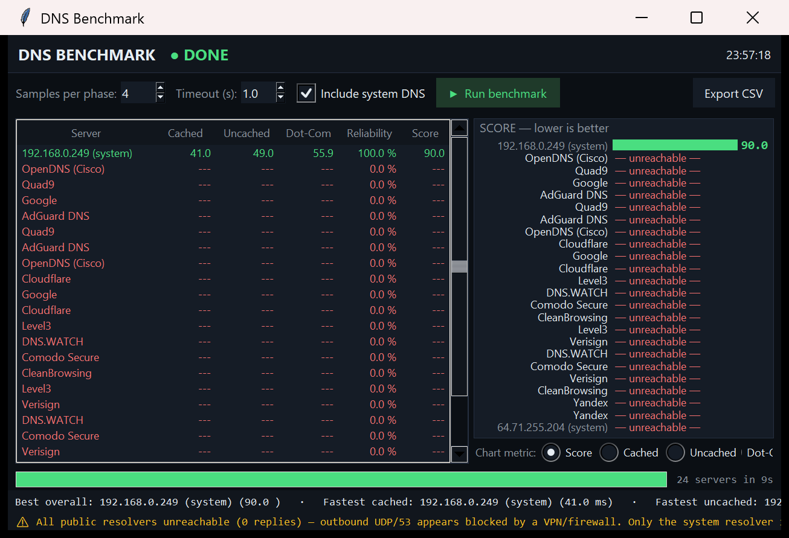

# DNS Benchmark (Python)

A GRC-style DNS resolver benchmark inspired by [GRC's DNS Benchmark](https://www.grc.com/dns/benchmark.htm).

It sends raw DNS queries over UDP (no third-party dependencies — Python 3.8+ standard library only) and measures:

| Metric | What it means |
|---|---|
| **Cached** | Median latency for popular domains (tests the resolver's cache speed) |
| **Uncached** | Median latency for random subdomains (forces real recursive resolution) |
| **Dot-Com** | Median latency for random `*.com` names (tests the TLD resolution path) |
| **Reliability** | % of queries answered, with automatic retransmission on timeout |
| **Score** | `(cached + uncached) / reliability` — lower is better |

Results are ranked and a summary shows the best overall, fastest cached, fastest uncached, and most reliable server.



## GUI

```bat
python dns_benchmark_gui.py
```

A dark-themed dashboard (matching the [WiFi Network Monitor](https://github.com/reinXman/wifi-network-monitor) style) that wraps the same benchmark core:

- **Live sortable results table** — click any column heading to re-sort; rows appear as servers finish
- **Rank-colored bar chart** — switch between Score / Cached / Uncached / Dot-Com
- **Per-query progress**, abortable runs, and **CSV export** of results
- **System resolver detection** (checkbox) — compare your ISP/router DNS against the big names
- Unreachable resolvers are detected fast (the warm-up probe doubles as a reachability
  check) and flagged — e.g. when outbound UDP/53 is blocked by a VPN/firewall

GUI options: `--samples N`, `--timeout T`, `--auto` (start benchmarking on launch).

## Requirements

- Python 3.8 or newer — no packages to install.

## Usage

```bat
python dns_benchmark.py                        :: test ~22 well-known public resolvers
python dns_benchmark.py --quick                :: faster run (10 samples per phase)
python dns_benchmark.py --servers 1.1.1.1 9.9.9.9
python dns_benchmark.py --system               :: also test your configured resolver(s)
python dns_benchmark.py --sort uncached        :: rank by a specific column
```

### Options

| Flag | Default | Description |
|---|---|---|
| `--servers IP ...` | built-in list | IP addresses of resolvers to test |
| `--system` | off | Also test the resolver(s) configured on this machine |
| `--samples N` | 40 | Queries per phase per server (use fewer for a quick test) |
| `--timeout SEC` | 2.0 | Per-query timeout |
| `--workers N` | 10 | How many servers are tested in parallel |
| `--sort KEY` | `score` | Sort results by `score`, `cached`, `uncached`, `dotcom`, or `reliability` |
| `--quick` | off | Shortcut for `--samples 10` |

A full run against all built-in servers takes a few minutes; use `--quick` for a fast pass.

## Example output

```
======================================================================================
Rank  Server                 Cached  Uncached   Dot-Com  Reliability     Score
--------------------------------------------------------------------------------------
1     192.168.0.249          39.7ms    47.3ms    55.4ms       100.0%        87
======================================================================================
```

## Notes

- Run it from a terminal so the window doesn't close when finished. If you want
  double-click support, append `input("\nPress Enter to exit...")` at the end of the file.
- Some firewalls block direct outbound UDP port 53 to arbitrary hosts; if every
  external server reports failures, that's likely the cause (your router/ISP
  resolver usually still works).
- Unlike GRC's version, this tool does not currently check DNSSEC validation,
  hijacking, or rebind protection.

## Files

- `dns_benchmark.py` — the benchmark core + CLI
- `dns_benchmark_gui.py` — the GUI dashboard
